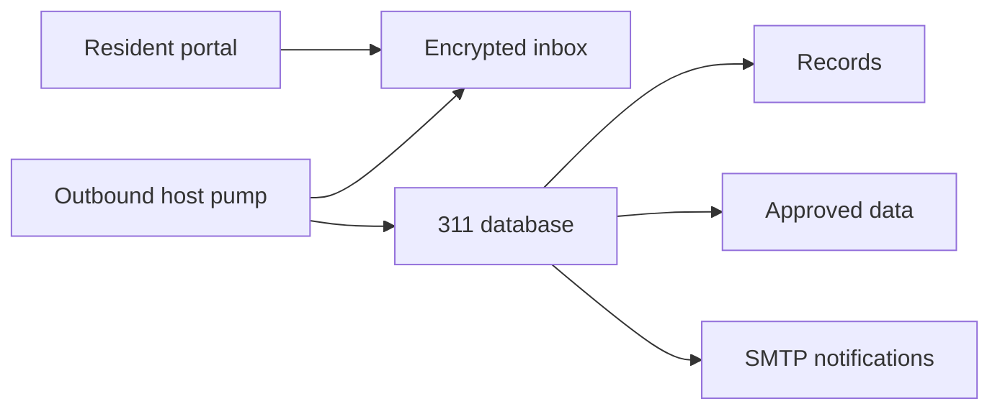

# Townlight 311 User Manual

> **Status: 0.2.0 source work — integration candidate only.** This has not been released and has not been tested as an installed Windows build. Nothing here is an acceptance claim or a release promise.

Townlight 311 is the Townlight module for resident service-request intake, privacy-aware tracking, staff workflow, records, notifications, and Open311-compatible interchange. The principal package is the distribution `townlight-311`, imported as `townlight_311`. The workflow library `townlight_311.workflow` is under integration verification; it is an integration candidate and is not installed. The implemented Windows routes are `/desktop/v1/service-requests`, with Open311 at `/desktop/v1/service-requests/open311/...`.

## For New Residents

- Submit a service request through resident intake.
- Receive privacy-aware tracking information; resident-facing tracking does not expose internal detail.
- If you lose access to your tracking information, use the recovery flow. Recovery is designed so staff never disclose another resident's data.

## For Staff

- Your current role controls what you can do. Existing native roles are `local-admin`, `city-staff`, `clerk`, `records-staff`, and `code-staff`. `local-admin` and `city-staff` have all active profile module capabilities. `clerk` has Meetings, Notice, Access, 311, Communications, and Parks workflow access, but not Records, Code, or Data. `records-staff` has Records only; `code-staff` has Code only.
- Staff workflow follows the staff lifecycle and role assignments maintained by administrators.
- Records producer archive handoff requires both the module and Records access, so use `city-staff` or `local-admin` for that handoff. Records retrieval can also use `records-staff`. Aggregate Data approval uses `local-admin`.
- Records are produced as ZIP archives that report the actual bytes written plus the operation history.
- You can import CSV or JSON data (see limits below) and preview it before commit.

## For Administrators

- Manage SMTP notification settings, including STARTTLS connection settings.
- Notification states are `sent`, `pending`, `failed`, and `uncertain`. Delivery is **not guaranteed**; `uncertain` means status is unknown after a send was attempted.
- Attachments are limited to **10 MiB** each.
- Import accepts CSV or JSON up to **2 MiB** and **1000 rows**, keyed by stable external IDs plus a source key, with an exact preview hash.
- Export is capped at **10,000 requests**; an export that would exceed the cap fails rather than truncating.
- Open311 support covers authenticated catalogue, read, and create with JSON/XML for the supported subset only. It is **not full Open311 conformance**.

## Technical Architecture

Residents submit through the resident portal into an encrypted inbox. The outbound host pump works with the encrypted inbox and persists into the 311 database. Records, approved data, and SMTP notifications are produced from the 311 database. Notification delivery is not guaranteed, and Open311 support is limited to the supported subset described above.

The old `townlight_311.main` module is a developer-only prototype helper API. It is not the Windows runtime and is not a complete standalone product. The implemented Windows routes are `/desktop/v1/service-requests`, with Open311 at `/desktop/v1/service-requests/open311/...`.
