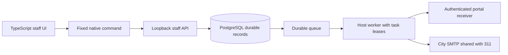

# Townlight Communications 0.2.0 User Manual

## Status and scope

Townlight Communications 0.2.0 is a development candidate for the Townlight Windows staff Communications screen. It is not part of the released Windows 1.9.3.2 suite. Distribution name: `townlight-comms`; import name: `townlight_comms`; current dependency: Townlight Core 1.3.0.dev2 (`townlight-core 1.3.0.dev2`).

The canonical application is the Communications workspace in the Townlight Windows staff shell with existing roles: local-admin and city-staff have all active profile-module capabilities plus Records; clerk has Meetings, Notice, Access, 311, Communications and Parks workflow access, but not Records, Code or Data; records-staff has Records only; code-staff has Code only. Aggregate Data approval uses local-admin. Records archive handoff and retrieval use the separate Records permission. The standalone `main.py` in this repository remains a prototype for draft helpers; it is not a secured workflow server or production deployment procedure.

## Staff workflow

1. Create or reopen a draft. Select sources from Meetings, Code, Notice or 311. The Parks adapter stays pending until the Parks phase.
2. Save the draft and run an Access check. Review and approve one exact revision. Approval applies to that revision only; later edits clear it.
3. Schedule publication to the website and email for the approved revision.
4. Publish, then archive the published revision to Records BEFORE editing, correcting, or withdrawing it; Records producer archive handoff requires both the module and Records access, so use city-staff or local-admin; Records retrieval can also use records-staff. Corrections preserve prior revisions, and withdrawal prevents stale content from being restored.

Captured approved source snapshots, public URLs, digests and revision provenance remain with the article. Public attachments require review. Private source content cannot be published, and missing, private or stale sources block approval.

## Portal, email and delivery

The host configuration supplies the portal credential and origin. Normal operation uses an unattended host service, not an operator window, so scheduled work can complete after the staff app closes. Website tasks travel through the existing authenticated portal receiver, with receipt URL and hash retained.

Email uses the city email settings shared with 311 SMTP. Subscribers must confirm their email address and can manage preferences or unsubscribe. Queued means pending, not SMTP accepted. Only sent means SMTP accepted the message, not human receipt. Failed and uncertain results are shown separately, and an uncertain send is never retried automatically. Deterministic message identifiers and durable records support safe retries only when non-delivery is known.

## Records and roles

The Records archive stores the actual published bytes, source references, attachments and receipts, and returns a real identifier. Records retrieval requires Records access. Existing staff roles continue to control drafting, review and approval; no resident account can see staff drafts or private source data. Publication metrics are limited to explicit approved aggregate reporting, not subscriber lists.

## Acceptance status

Source-level checks passed for this development candidate, but installed Windows candidate acceptance remains pending. Acceptance must prove staff two-PC authoring, exact-revision approval, scheduling, app-closed host publication to the portal and controlled SMTP, correction and withdrawal, restart survival, and Records retrieval. Source tests are not installed acceptance. Do not describe this module as completed or released. The existing download at https://github.com/townlight/townlight/releases/latest explicitly does not include Communications.

## Technical architecture

The desktop runtime is `/desktop/v1/communications`, protected by native staff authentication. Browser requests use a fixed native command allowlist and cannot choose arbitrary URLs. Portal inbound operations use encrypted authenticated inbox and pump patterns; the desktop service remains private. Production uses a real PostgreSQL schema with explicit migration; SQLite translation is for tests, and production bootstrap is false. Revisions are immutable and approval binds the exact public-content hash. Optimistic revisions and database transactions prevent two-PC lost updates. Plain text is stored and escaped paragraphs are rendered; HTML is not trusted.

Source eligibility is checked at runtime against the owning module; user-supplied flags cannot authorize publication. The email outbox has durable state separate from 311, and subscriber tokens are hashed and private. The host service owns portal credentials and origin configuration.

Back up database data, profile keys, durable queue work and Records files as one unit. The product does not provide Mac or Linux installation instructions.

Documentation authoring and translation provenance are recorded separately from product implementation.
