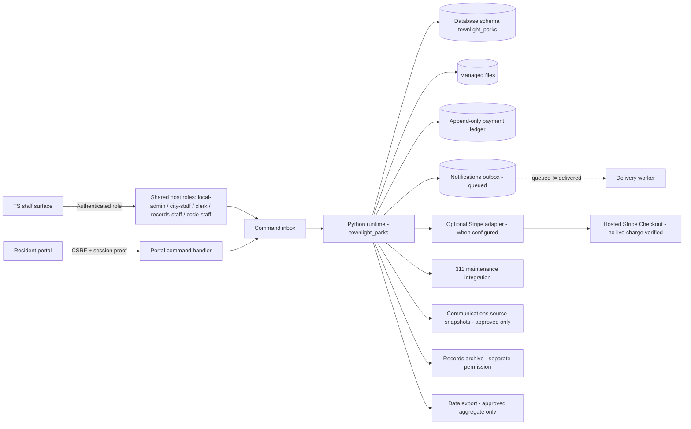
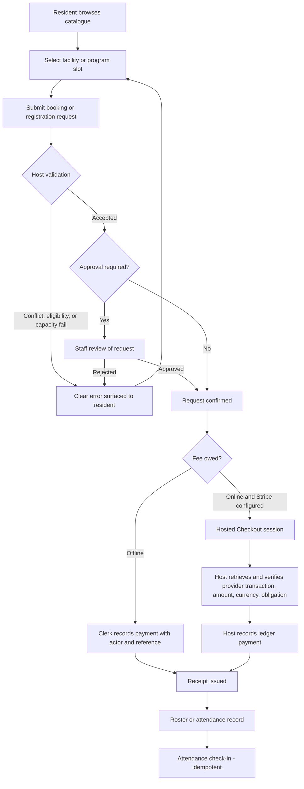

# Townlight Parks 0.2.0 — User Manual (Source Candidate)

**Status:** This manual documents the `townlight-parks` 0.2.0 **source integration candidate**. It is not an installed build, not a signed installer, and not a download. The existing public Windows release `1.9.3.2` does **not** include Parks. Final signed combined Suite acceptance is still pending.

Nothing in this manual asserts that a verified signed artifact has been installed, that acceptance testing has passed, or that any live payment has been processed. Where behavior depends on hosted providers, the manual describes the intended verification path and explicitly marks the "no live charge verified" state.

- Package: `townlight-parks==0.2.0`
- Import: `townlight_parks`
- Core target: `townlight-core==1.3.0.dev2`
- Target platform: Windows, Python `>=3.11`
- Database schema: `townlight_parks` (production bootstrap `False`; explicit migrations only)

---

## 1. Scope and status

Townlight Parks is a source-level addition to the Townlight Suite for parks and recreation workflows. In this candidate it provides, at source level:

- Public facility and program catalogue and availability views.
- Booking and registration for residents.
- Session rosters, waitlists, promotion and attendance.
- Household, participant, and minor data held privately.
- Fees, deposits, refunds and reconciliation in integer cents with explicit currency.
- Offline payment and refund recording in an append-only ledger.
- An optional hosted Stripe Checkout adapter that verifies the provider transaction, amount, currency and obligation identity at the host before any ledger record is created. No Stripe account is configured in this candidate and **no live charge has been verified**.
- Maintenance links that create real 311 requests with durable idempotency and returned 311 request identity.
- Explicitly approved Communications source snapshots.
- Records private ZIP archive/readback and approved aggregate Data export.
- Notifications are recorded as queued items; **queued is not the same as delivered**.

This manual does not promise PyPI availability, a scheduled release date, or signed-artifact acceptance. The source tree is the object of verification; the installed and signed states are pending.

---

## 2. Roles and access

Existing Suite roles remain in force:

- `local-admin` — configures the local instance, staff accounts, and permitted integrations; has all active profile module capabilities, including Records and Aggregate Data approval.
- `city-staff` — operates day-to-day Parks workflows (facilities, programs, sessions, bookings, payments, maintenance links, notifications review); has all active profile module capabilities, including Records.
- `clerk` — records and reconciles offline payments and refunds and manages receipts within the scope assigned by `local-admin`; has Meetings, Notice, Access, 311, Communications and Parks workflow access, but not Records, Code or Data.
- `records-staff` — has Records access only.
- `code-staff` — has Code access only.

Records archive access is controlled by the Records capability: `local-admin` and `city-staff` have it, while `clerk` does not; `records-staff` has Records access only. Records producer archive handoff requires both the relevant module workflow access and Records access, so use `city-staff` or `local-admin` for that. Records retrieval can also be performed by `records-staff`. Aggregate Data export requires explicit **approval** by `local-admin` as described in §12. Public pages expose catalogue and availability only, and never household, participant, minor, accommodation, contact or private tracking details.

A standalone `main.py` is retained as a foundation/demo entry point. It is not the full Suite authentication path, not a normal installer, and not the ordinary city-staff deployment route. Ordinary city staff should use the upcoming Suite candidate.

---

## 3. Architecture

The following describes the source-level architecture. It does not assert a deployed topology.

Durable command identities in the inbox prevent replay-driven duplication. The host applies queued work only when its preconditions hold; a queued notification is not evidence of delivery.

---

## 4. User flow (resident booking and registration)

The host is the authority. Provider return URLs are **not** payment proof; only a host-side verification of the provider transaction, amount, currency and obligation identity leads to a ledger payment record.

---

## 5. Facilities, programs and hours

### 5.1 Timezone and DST review

Each facility and program carries an explicit timezone. Hours are reviewed against that timezone before they are shown publicly or used for availability. Daylight-saving transitions are reviewed explicitly by staff: the review step exists because a locally stated hour is not the same instant across a DST boundary, and booking, closure and buffer arithmetic must use the resolved instant. Do not assume that a stated local clock time maps to a single UTC instant on a transition day.

### 5.2 Buffers and closures

Facilities support setup and cleanup buffers. Buffers are applied around a booking when availability is evaluated and when the reservation is locked. Closures and blackouts suppress availability for the affected windows and are themselves evaluated in the facility's timezone.

Availability shown on public pages reflects catalogue and availability only; it does not reveal household, participant, minor, accommodation, contact, or private tracking details.

---

## 6. Households and minors

Households group participants. Participant and household records are private. Minor records, accessibility/accommodation notes, and contact details are private and are not exposed to public pages or to aggregate exports. Staff access to household and participant records is limited by role and by the Records permission where archived material is involved.

Where a workflow requires accommodation information, that information is collected through the private staff path and is not surfaced in the public catalogue or availability response.

---

## 7. Bookings

### 7.1 Recurrence, conflicts and locking

A facility reservation may be single or recurring. When a request is stored:

- The resource and session rows are locked in the same transaction as the overlap checks and occupancy writes.
- Recurrence is applied **all or nothing**; a recurrence that would conflict as a whole is rejected as a whole, and partial writes are not left behind.
- Locks are acquired in a stable order so that concurrent requests do not deadlock.

Conflicts produce a clear, resident-facing error that explains which slot or constraint failed and how to revise the request. There are no "silent" partial bookings.

### 7.2 Approval, reschedule and cancel

Approval may be required per facility or per program, at staff discretion. Reschedule and cancel are staff or resident actions subject to the same locking discipline as creation: a reschedule is validated against conflicts and buffers before it is applied, and a cancel releases occupied windows and records the change against the durable command identity.

A rejected or failed request returns an error that names the constraint (for example, overlap, buffer, closure, or approval denied) and a concrete revision path. Retrying a rejected request without a revision is expected to fail again; the error is guidance, not an invitation to retry blindly.

---

## 8. Sessions, capacity and attendance

### 8.1 Capacity and age eligibility

Programs and sessions carry eligibility rules, including age ranges where configured, and a capacity. Registration is checked against eligibility and remaining capacity under the same transactional discipline used for facility reservations.

### 8.2 Waitlists and promotion

When a session is full, a registration may be placed on a waitlist. Promotion from waitlist occurs against the session's capacity, with durable command identity so a retried promotion is not duplicated. Promotion does not silently exceed capacity.

### 8.3 Rosters and attendance

Session rosters are private to staff permitted to see them. Attendance check-in is idempotent: a repeated check-in for the same attendee and session does not create a second attendance record. Rosters and attendance are excluded from public pages and from aggregate Data exports containing participant detail.

---

## 9. Payments and refunds

All fee arithmetic is in integer cents with an explicit currency. Deposits and refunds are also represented in integer cents with the session's currency.

### 9.1 Offline payments and refunds

Offline payments and refunds are recorded in an **append-only ledger**. Each entry carries the staff actor and a reference. Corrections are made by adding an opposite entry, not by editing history. Receipts are issued from ledger records.

### 9.2 Optional hosted Stripe Checkout (when configured)

The hosted Stripe adapter is optional. In this source candidate **no Stripe account is configured and no live charge has been verified**.

When it is configured by an operator, the intended path is:

1. The host creates a Checkout session for a specific obligation.
2. The resident completes Checkout at the hosted provider.
3. The host retrieves the provider transaction and verifies the transaction identity, amount, currency and obligation identity against its own records.
4. Only after that verification does the host append a ledger payment.

Provider return URLs are not payment proof. A resident returning from a cancelled or interrupted Checkout is not evidence of payment. Card data does not enter Townlight; only provider identifiers and verified amounts are recorded. Ambiguous provider outcomes are reconciled before retry, and payment intents and refund intents persist across restart.

---

## 10. Maintenance links and 311

Maintenance workflows create **real** 311 requests, not local placeholders. Each link carries a durable idempotency key so a retried submission does not create a duplicate 311 request. The recorded location and photo bytes are the actual submitted bytes. The returned 311 request identity is stored with the link so that staff can track progress and resolution against the real request.

Staff can view the progress and resolution state of a linked 311 request within the Parks surface. The 311 integration is the source of truth for the request lifecycle; Parks does not assert a status the 311 system has not returned.

---

## 11. Attachments and Records

Attachments are private. The Records archive is a private ZIP archive/readback path and is controlled by the separate Records permission. For archive review, the operator should rely on the **exact content hash** produced by the review step: the hash identifies the archived content that was reviewed, rather than a filename or a description of contents.

Records archive access is controlled by the Records capability: `local-admin` and `city-staff` have it, `clerk` does not, and `records-staff` has Records access only. Records producer archive handoff requires both the relevant module workflow access and Records access, so use `city-staff` or `local-admin` for that; Records retrieval can also be performed by `records-staff`. When in doubt, verify the exact content hash and the access check rather than relying on a filename.

Public pages never expose attachments, archive contents, archive hashes, household or participant data, accommodation notes, or private tracking identifiers.

Aggregate Data exports are restricted to the approved aggregate scope described in §12; participant, contact and accommodation details are excluded.

---

## 12. Admin aggregate data approval

Aggregate Data export requires explicit approval by `local-admin`. Approval is a discrete action that records who approved the export and what aggregate scope was approved. The export is restricted to that scope and excludes participant, contact and accommodation details. Approval is available to `local-admin` and is not available to `clerk`, `records-staff` or `code-staff`; it is a separate gate.

---

## 13. Notifications

Notifications are recorded in an outbox. A queued notification is **queued, not delivered**. The delivery worker is a separate step and its success is not assumed by the queue record. Staff reviewing notifications should distinguish queued state from delivered state, and should not treat the presence of a queued entry as evidence that the resident received it.

Retries at the delivery layer are the responsibility of the delivery worker and are expected to be safe against duplicate commands, but queued work is not confirmed until the host applies it.

---

## 14. Technical operations

### 14.1 Stack and host roles

The Suite combines TypeScript staff surfaces with a Python runtime, resident portal and encrypted command handling. Parks reuses the shared command/session proof and allocation-receipt approach used by 311 and Communications. Host roles are `local-admin`, `city-staff`, `clerk`, `records-staff` and `code-staff`. `local-admin` and `city-staff` have all active profile module capabilities; `clerk` has Meetings, Notice, Access, 311, Communications and Parks workflow access but not Records, Code or Data; `records-staff` has Records only; `code-staff` has Code only. Target platform is Windows with Python `>=3.11`.

### 14.2 Migrations

Production bootstrap is `False`. Tables are created only through explicit, programmatic migrations invoked from the package migrations module: `migrations.upgrade(engine)` followed by `migrations.assert_ready(engine)`. This source candidate does **not** add a migration CLI, and this manual does not invent command-line syntax for migrations. Operators should call the migrations module from their own deployment code and rely on `assert_ready` to fail closed if the schema is not ready.

### 14.3 Encrypted keys and portal CSRF

Profile encryption keys are held encrypted and are not present in source control, configuration files, logs, or the repository. The resident portal applies CSRF protection and session ownership checks to resident commands. Secrets and card details must not be placed in configuration files, logs, or the repository.

### 14.4 Command inbox and source API privacy

Durable command identities in the inbox prevent replay duplication. The source API must not expose private household, participant, minor, accommodation, contact, attachment, or private tracking details; public responses are limited to catalogue and availability. Queued work is not confirmed until the host applies it. Ambiguous provider outcomes are reconciled before retry.

### 14.5 Backup and restore

Back up the database, managed files, portal inbox, profile encryption keys and publisher queue **together**. Restore preserves the relationship between durable command identities, ledger entries, and queued work. Payment intents and refund intents persist across restart. After a restart, the runtime reopens durable requests and resumes known-safe jobs without duplicates; a resumed job is not evidence of delivery or of provider settlement until the host re-verifies.

---

## 15. Errors, retry and revision guidance

- A failed validation returns a clear error naming the constraint that failed (for example: timezone or DST resolution, buffer, closure, overlap, capacity, eligibility, approval denied, or provider verification).
- A rejected request is not automatically retryable as-is. The error identifies what to revise; retrying without a revision is expected to fail again.
- Retries of accepted commands are safe against duplication because of durable command identities, unless the command was explicitly rejected.
- Provider payment outcomes that are ambiguous are reconciled against the provider before a retry is attempted.
- Queued notifications and resumed jobs are not confirmed until the host applies them; do not treat queue state as delivery state.

This manual deliberately does not invent command-line syntax, HTTP endpoints, or UI button labels. Operators should use the surfaces shipped with the Suite candidate, once signed and installed, rather than guessed command lines or endpoints.

---

## 16. Acceptance status

- The `townlight-parks` 0.2.0 **source tree exists and is the object of verification**.
- The public Windows release `1.9.3.2` does **not** include Parks.
- The final signed combined Suite candidate is **pending**.
- Installed-build and production **acceptance is pending**.
- The hosted Stripe path is documented as an optional, when-configured adapter; **no live charge has been verified** in this candidate.
- Notifications are queued, and queued is **not** delivered.

Operators should treat this document as describing a source integration candidate in the state above, not as an installation, release, or acceptance record.
